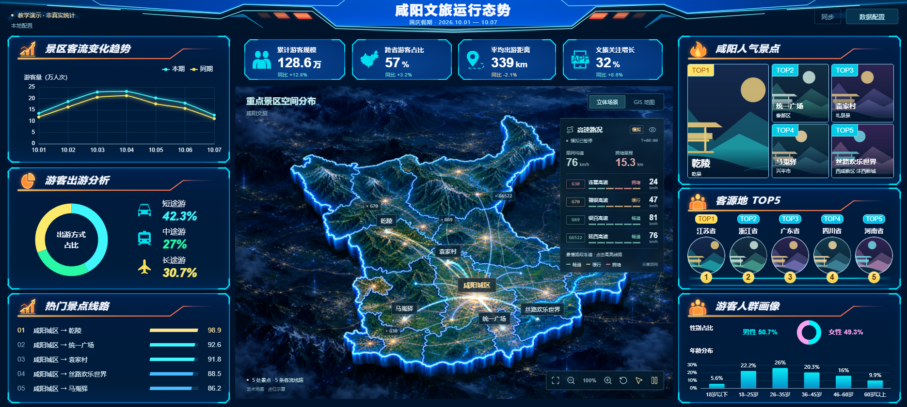

# Frontend Dashboard Lab · 前端大屏教学实验室

从一个能运行、可配置的文旅大屏出发，学习前端模块化、DOM/CSS、ECharts、异步数据流、Web Worker、WebGL 与 AI Skill。使用原生 JavaScript，不要求先学 React/Vue。

本项目是教学示例，不是生产统计系统。数字、客流、路况均为模拟；景点配图是明确标注的示意插图；地图不用于导航或测绘。



## 5 分钟启动

需要 Node.js 22.21+、npm 和支持 WebGL2 的现代浏览器。克隆本仓库后，在仓库根目录运行：

```sh
npm run setup
npm run dev
```

打开 [本地大屏](http://127.0.0.1:5199)。Windows 如遇 PowerShell 脚本策略限制，用 `npm.cmd` 替代 `npm`，不需要修改系统执行策略。

`setup` 只安装 `apps/dashboard` 与 `packages/img2code` 的锁定依赖。没有根级 workspace 提升，也不需要全局安装包。各模块使用各自的 `package-lock.json`。安装存在上游弃用/安全公告，详见 [安全边界](SECURITY.md)。

## 仓库导航

```text
apps/dashboard/             可运行的大屏应用
  src/main.js               样式加载与启动入口
  src/app/                  启动、渲染编排、舞台缩放、地图复用
  src/components/           标题、指标、图表面板、景点、客源地、详情
  src/shared/               DOM 工具、纯数据选择器
  src/config/               契约、表单、保存、API、Excel Worker
  src/gis/                  图片场景、GIS、飞线、模拟交通层
  public/                   默认配置、教学插图、地图与地形
  tests/                    Node 单元测试
  tools/                    演示服务、浏览器回归、地形和模板工具
packages/img2code/           截图、裁切、像素比较与本地对照页面
skills/screenshot-to-web/    可独立安装的截图还原 Skill（含工具快照）
docs/                       课程、架构、运行指南、发布与素材说明
scripts/                    Skill 一致性与发布检查
.github/workflows/          CI；可手动触发的 GitHub Pages 部署
```

## 怎么学

先看 [课程地图](docs/COURSE.md)，再按顺序完成 [各课练习](docs/lessons/01-modules.md)。每课都有目标、源码入口、实际修改任务和验收方法。想先了解全貌，阅读 [模块与数据流](docs/ARCHITECTURE.md)。

| 阶段 | 学习重点 | 从哪里开始 |
| --- | --- | --- |
| 1–2 | ESM、职责划分、DOM、CSS、SVG、缩放 | `src/main.js`、`src/components` |
| 3–4 | 数据驱动图表、不可变排序、配置校验、本地保存 | `src/charts.js`、`src/config` |
| 5–6 | fetch 取消/超时、Worker、地图与动画资源管理 | `src/config/api.js`、`src/gis` |
| 7–8 | Skill、截图验证、负对照、测试和静态发布 | `skills`、`packages/img2code` |

## 常用命令

```sh
npm test                 # 单元测试，60 秒边界
npm run build            # 产物：apps/dashboard/dist
npm start                # 生产构建 + 本机只读演示 API
npm run test:browser     # 图片场景交互回归（需先 build）
npm run test:toolkit     # 图像工具正负对照与冻结截图
npm run skill:check      # Skill 元数据、资源、快照一致性
npm run release:check    # Git 待发布文件、路径、敏感信息检查
npm run verify          # 构建、全套应用回归、工具和 Skill 验证
```

浏览器测试优先尝试系统 Chrome / Edge，再尝试 Playwright 浏览器。若均不可用，先在 `packages/img2code` 运行 `npx playwright install chromium`。完整依赖、超时与故障处理见 [运行指南](docs/RUNNING.md)。

## Skill 也是教材

`skills/screenshot-to-web` 不只是提示词：它包括触发描述、工作流程、按需参考资料、CLI 和确定性截图检查。阅读 [Skill 安装与设计](docs/SKILLS.md)。

```text
使用 $screenshot-to-web，按参考图实现可编辑页面，给出前后截图和剩余差异。
```

Skill 和 img2code 本身不调用模型 API，也不会自动生成页面；AI 代理负责理解与实现，工具负责测量与复核。

## 发布与素材边界

GitHub 授权、建仓与上传步骤见 [发布指南](docs/PUBLISHING.md)。Pages 只能托管静态文件，不包含 `/api/dashboard` 演示服务；默认本地配置模式可直接运行。

[素材说明](docs/ASSETS.md) 区分自绘插图、用户提供的地图和第三方地形数据。原第三方景点照片、旧截图、个人凭据和 APK 不在发布集合中。用户提供的地图再分发权限仍需作者确认；本仓库没有擅自给全部素材套用 MIT 等许可证。

最新实际测试记录见 [验证记录](docs/VALIDATION.md)。安全检查与测试通过不代表已完成生产 API、安全审计或地图合规审核。
